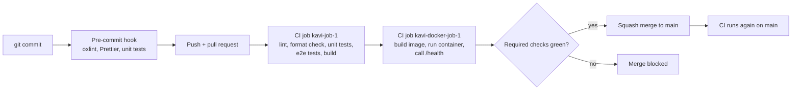

# devops-1

A small NestJS API used to practise a full CI pipeline: local checks before a commit, automated checks on every pull request, a Docker image that is built and started in CI, and a protected `main` branch.

The app has one endpoint that matters for the pipeline:

```
GET /health  →  {"status":"ok"}
```

## Pipeline



| Stage | Where it runs | What it checks | Can it be skipped? |
|---|---|---|---|
| Pre-commit hook (`.husky/pre-commit`) | Developer laptop, on `git commit` | oxlint and Prettier on staged `.ts` files, unit tests | Yes, `git commit --no-verify` |
| `kavi-job-1` (`.github/workflows/ci.yml`) | GitHub Actions, Ubuntu | `npm ci`, lint, format check, unit tests, e2e tests, build | No, required check |
| `kavi-docker-job-1` | GitHub Actions, Ubuntu, after `kavi-job-1` | Docker image builds, container starts, `/health` answers | No, required check |

## Branch protection

`main` is protected by the `protect-main` ruleset:

- Changes reach `main` only through a pull request.
- `kavi-job-1` and `kavi-docker-job-1` must pass before merging.
- `main` cannot be deleted or force-pushed.
- Pull requests are merged with squash only, so each pull request becomes one commit on `main`.

## Run locally

```bash
npm ci
npm run start:dev
curl http://localhost:3000/health
```

Checks (the same commands CI runs):

```bash
npm run lint
npm run format:check
npm test
npm run test:e2e
npm run build
```

`npm ci` also installs the pre-commit hook (the `prepare` script runs Husky).

## Run in Docker

```bash
docker build -t devops-1 .
docker run -d --name devops-1 -p 3000:3000 devops-1
curl http://localhost:3000/health
docker stop devops-1 && docker rm devops-1
```

The `Dockerfile` has two stages:

1. **build**: installs all packages and compiles TypeScript into `dist`.
2. **final image**: installs runtime dependencies only (`--omit=dev`), copies `dist` from the build stage, runs as the non-root `node` user and starts `node dist/main`.

The app listens on `PORT` (default `3000`), so another port can be set at start time:

```bash
docker run -d -e PORT=7777 -p 3000:7777 devops-1
```

The app enables NestJS shutdown hooks, so `docker stop` ends it cleanly (exit code 0) instead of force-killing it after 10 seconds.
