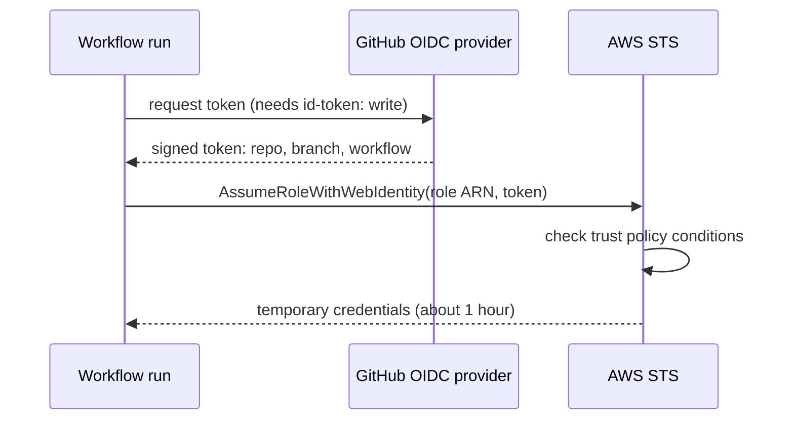

# How a CI/CD pipeline logs in to AWS

## IAM in one table

| Term | Meaning |
|---|---|
| IAM user | A long-lived identity, usually for a person. Can have access keys (an ID + secret) that work until someone deletes them. |
| IAM role | An identity with no password or keys of its own. Someone or something *assumes* it and gets temporary credentials (typically valid for an hour). |
| Policy | A JSON document listing allowed actions on resources, attached to a user or role. |
| Trust policy | The part of a role that says *who* is allowed to assume it. |
| Least privilege | Grant only the actions and resources a job needs, nothing more. |

## Can an IAM user be used by the pipeline to deploy?

Yes. Create an IAM user, create access keys, store them as GitHub secrets (`AWS_ACCESS_KEY_ID`, `AWS_SECRET_ACCESS_KEY`), and the workflow logs in with them:

```yaml
- uses: aws-actions/configure-aws-credentials@v4
  with:
    aws-access-key-id: ${{ secrets.AWS_ACCESS_KEY_ID }}
    aws-secret-access-key: ${{ secrets.AWS_SECRET_ACCESS_KEY }}
    aws-region: ap-south-1
```

The risks come from the keys being long-lived:

- They work from anywhere, for anyone who has them, until they are rotated or deleted.
- A leak (a log line, a compromised workflow, a copied secret) gives lasting access.
- They have to be rotated by hand, and the same keys are often shared by many workflows.

## The alternative: GitHub OIDC + an IAM role

GitHub can give each workflow run a short-lived signed token (OpenID Connect, OIDC) that says exactly which repository, branch and workflow is running. AWS checks that token and hands back temporary credentials for a role. No AWS secret is stored in GitHub.



One-time setup in AWS:

1. Add an identity provider in IAM: URL `https://token.actions.githubusercontent.com`, audience `sts.amazonaws.com`.
2. Create a role whose trust policy only accepts tokens from this repository's `main` branch:

```json
{
  "Version": "2012-10-17",
  "Statement": [
    {
      "Effect": "Allow",
      "Principal": {
        "Federated": "arn:aws:iam::<ACCOUNT_ID>:oidc-provider/token.actions.githubusercontent.com"
      },
      "Action": "sts:AssumeRoleWithWebIdentity",
      "Condition": {
        "StringEquals": {
          "token.actions.githubusercontent.com:aud": "sts.amazonaws.com",
          "token.actions.githubusercontent.com:sub": "repo:kaviyarasanss/devops-1:ref:refs/heads/main"
        }
      }
    }
  ]
}
```

3. Attach a least-privilege policy to the role, for example: push images to one ECR repository and update one service.

The workflow then needs no AWS secrets:

```yaml
permissions:
  id-token: write   # allow the job to request the OIDC token
  contents: read

steps:
  - uses: aws-actions/configure-aws-credentials@v4
    with:
      role-to-assume: arn:aws:iam::<ACCOUNT_ID>:role/<ROLE_NAME>
      aws-region: ap-south-1
```

## Side by side

| | IAM user + access keys | OIDC + IAM role |
|---|---|---|
| Secret stored in GitHub | Yes, long-lived | None |
| Credential lifetime | Until deleted | About an hour per run |
| Can be limited to one repo / branch | No, anyone with the keys | Yes, by the trust policy |
| Rotation | Manual | Not needed |
| If leaked | Usable until revoked | Expires quickly, and only works for that repo/branch |

## What a demo should show

1. Identity: the workflow run, identified by repo + branch in the OIDC token.
2. Permissions: the role it assumes and the policy attached to it.
3. Resources: only the registry and service named in that policy.
4. Missing permissions: AWS returns `AccessDenied` and the workflow step fails.
5. Least privilege: a leaked or misused run can only touch what the role allows.
