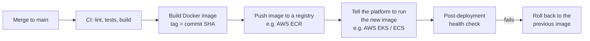

# From a merged commit to a running app

CI answers "is this change safe to merge?". Deployment (CD) takes the merged code and makes it run for users. A typical container deployment adds these stages after CI passes on `main`:

| Stage | What happens | In this repository |
|---|---|---|
| Build image | `docker build` packs `dist`, runtime packages and Node into one image | `Dockerfile`, built in CI by `kavi-docker-job-1` |
| Registry | The image is uploaded and stored, tagged with the commit SHA so every deploy can be traced to a commit | Not used; images stay local |
| Run | A platform (Kubernetes, ECS, a VM with Docker) pulls the image and starts containers, usually several copies | `infra/main.tf` runs one container on the local Docker engine with Terraform |
| Health check | After the new version starts, the pipeline calls a health endpoint and only reports success if it answers | `GET /health`, called by `kavi-docker-job-1` after starting the container |

## Who does what

- **CI** runs on every pull request and on `main`. It never needs the app to be deployed.
- **The registry** is storage only; nothing runs there.
- **The platform** decides where containers run, restarts crashed ones and replaces old versions with new ones.
- **The image's `CMD`** decides what starts inside each container (`node dist/main` here).
- **Shutdown hooks** (`app.enableShutdownHooks()`) let the platform stop old containers cleanly during a deploy.

## Credentials

Pushing to a registry and updating the platform needs cloud credentials, so a deploy workflow must log in to the cloud account. How a pipeline should get those credentials is covered in [aws-iam-oidc.md](aws-iam-oidc.md).
